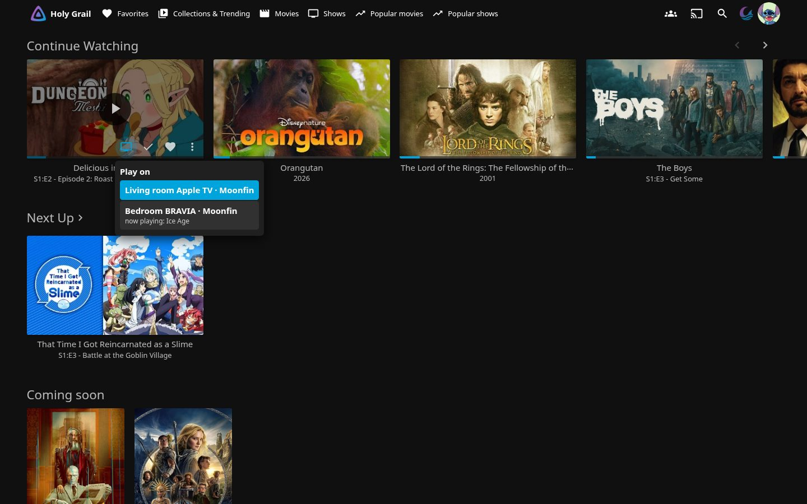
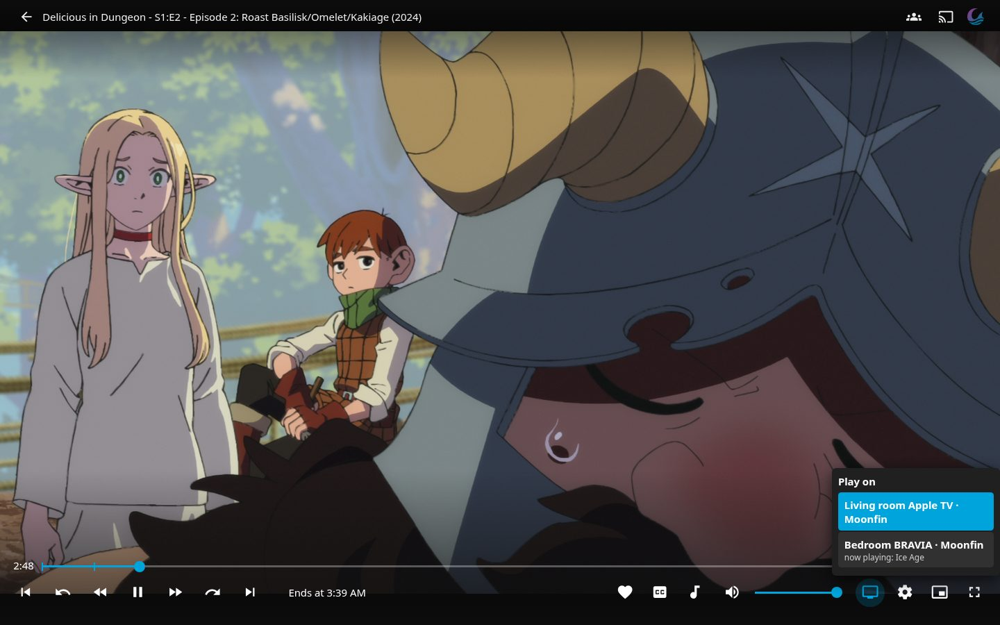
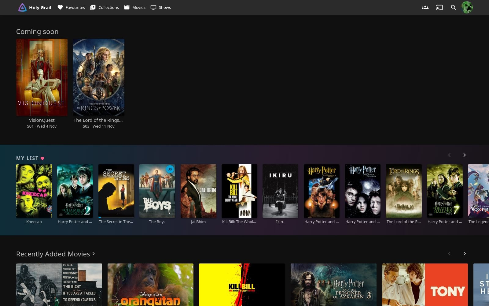
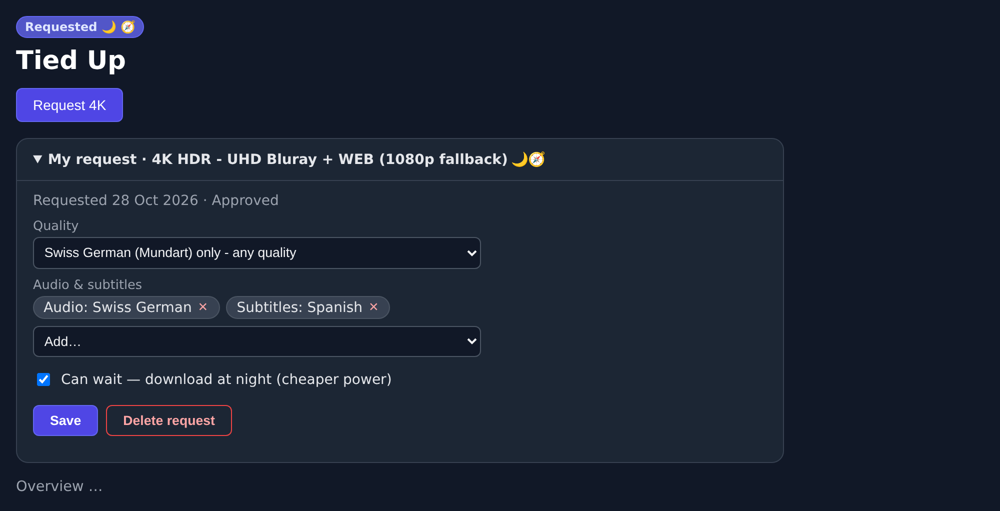

# What's new

Newest first. Each entry: what changed, where to click, and the page with the details.

## 22 November 2026

**Rows by region on the home.** After **Hidden Gems**: Nordic, Spanish-language, French, Swiss & German-language films and series, plus Anime and Japanese, on the Jellyfin website and in Moonfin. New regions appear by themselves once there are 4 titles. [Jellyfin home screen](apps/jellyfin-home.md#rows-top-to-bottom)

**Download to your computer: full file or phone version.** In the browser and the Jellyfin desktop app, **⋮** → **Download** on a 4K title asks: **Full file** (up to 30 GB) or **Phone version** (1080p HDR, about 1–2.5 GB per hour). Moonfin on Windows, Mac and Linux offers the same choice as on the phone. [Download to your computer](apps/jellyfin.md#download-to-your-computer)

**Download to your phone: pick the size.** In Moonfin, **Original** downloads the full file; **High**, **Medium**, **Low** or **Mobile** all download the smaller phone version (about 1–2.5 GB per hour instead of up to 30 GB per film). No phone version yet? The first tap orders it, a ✅ message tells you when to tap again. [Download to your phone](apps/moonfin.md#9-download-to-your-phone)

<!-- only: streaming-requesters -->
**Delete early.** Watched it and don't need it anymore? Title page in Requests → **🗑 Delete early** (series: whole or one season). 7 days in the recycle bin with **↩ Restore**, 10 per week; Keep forever titles and titles someone is watching need their OK. [Delete early](apps/retention.md#delete-early)
<!-- /only -->

**Old formats in 2160p.** Films and episodes in old formats (DVD, VC-1, XviD, WMV, interlaced) get a second version, **2160p upscale**, made at night, so TVs and phones play them without converting. [2160p upscale version](apps/jellyfin.md#2160p-upscale-version)

## 21 November 2026

**Report a problem.** A film or episode won't play, or picture or sound is broken? Report it on `https://report.holy-grail.ch`, or with **⚠ Report a problem** on its page in Jellyfin (browser). The server blocks the broken version and downloads another one by itself. [Report a problem](apps/report.md)

## 16 November 2026

**Titles leave after 3 months, great ones stay.** A title leaves the server 3 months after the download or the last play (watching starts the 3 months again). Old, rare and top-rated titles stay forever. In Jellyfin, **Leaving soon** shows what goes in the next 7 days, **Left the server** what can be downloaded again. [How long titles stay](apps/retention.md)

<!-- only: streaming-requesters -->
**♾️ Keep forever.** Tick it when requesting, or press it on a title page under **On the server**, which also shows the leaving date. [Keep forever](apps/retention.md#keep-forever)
<!-- /only -->

**Wrong-language downloads blocked.** A download without German, English or original-language sound is blocked right after the download and searched again. [Audio & subtitles](audio-subtitles.md)

## 15 November 2026

**Login on one page.** Username and password go on the same page, then the 6-digit code. A **Forgot password?** link works for 10 minutes. [Getting started](getting-started.md#3-log-in)

<!-- only: streaming-requesters -->
**Audiobooks with the Requests menu.** The audiobook site now has the same sidebar (computer) or bottom bar (phone) as Requests, so you can jump between films and books. [Requesting audiobooks](apps/audiobook-requests.md)
<!-- /only -->

<!-- only: streaming-requesters -->
**New page: Manual interaction.** In the Requests site's menu (German: *Manuell beheben*), with a number when something needs a hand: downloads that went wrong, titles nothing was found for, files that could not be sorted in. Anyone with request access can help: pick the right title, assign files to episodes, block a wrong release and search again, or switch an old title to "older versions allowed". **Read description** checks a release's languages, and after 7 days with nothing found **Download anyway** takes a release that is not normally allowed. [Manual interaction](apps/requests.md#manual-interaction)
<!-- /only -->

<!-- only: streaming-requesters -->
**Own collections.** Requests menu → **Collections**: make a list from a search like `producer:Adam Sandler`. It shows in Jellyfin under **Collections & Trending** for everyone, missing titles downloadable like Top 10. [Own collections](apps/requests.md#own-collections)
<!-- /only -->

<!-- only: streaming-requesters -->
**Finished or not.** Requests page → filter → **✅ Request fulfilled** or **⏳ Request not yet finished**. On a title page, **⚡ Download now** says when it isn't needed: **🌙 Low tariff** (downloads now anyway) or **⏳ Nobody is sharing this file right now**. [Finished or not](apps/requests.md#finished-or-not)
<!-- /only -->

<!-- only: streaming-requesters -->
**Requests page: more at a glance.** Next to the seasons you see how many episodes there are; the size line shows the average per episode (`⌀ 4.2 GB/ep`) and per hour (`10.1 GB/h`), with ⚠️ **Remux** or ⚠️ **very big** for unusually large files. The **GB** sort now also sorts per file and per hour. A title that was removed from the server says so (⚠️) instead of "waiting for the night". [Requests](apps/requests.md)
<!-- /only -->

**Anime: smaller files, same picture.** Anime series are downloaded in the best 1080p version without huge disc copies (remuxes), anime films up to 4K HDR, with the same sound and language rules as everything else. Existing remux episodes are replaced over the next nights.
<!-- only: streaming-requesters -->
[Which version gets downloaded](apps/requests.md#which-version-gets-downloaded)
<!-- /only -->

**On a phone, Jellyfin in the browser points you to the Moonfin app.** Phone browsers can't play most of our films directly, so the server has to convert them (no 4K HDR, slower start). When you open Jellyfin or press play in a phone browser, you are offered the free Moonfin app, with a direct link to the App Store or Google Play. [Moonfin app](apps/moonfin.md)

## 14 November 2026

**Waking page counts up.** While the media server wakes, the page shows how long it has been waking. [Why you sometimes wait](apps/waiting.md)

**New step-by-step pages.** [How to watch](apps/watch.md) (browser, phone, TV, first login with Quick Connect), [Why you sometimes wait](apps/waiting.md) (the media server sleeps), [My request isn't there yet](apps/request-help.md) and a new [Listen to audiobooks](apps/audiobookshelf.md) with the phone app. A TV that only refreshes its home screen no longer wakes the server.

**The sign-up guide is open to everyone.** [Getting started](getting-started.md) can be read without an account, and now ends with picking your profile picture.

## 9 November 2026

**No more trailers playing on their own in Moonfin.** The big banner at the top of the home screen shows pictures only; a trailer plays only when you press it. Restart the Moonfin app once. [Media guide](apps/media-guide.md)

<!-- only: streaming-requesters -->
**New longer cuts are picked up.** Re-released longer versions such as *Avengers: Endgame Encore* now count as a longer cut: once one can be downloaded, films you have are upgraded to it at night. [Upgrades and editions](apps/requests.md#upgrades-and-editions)

<!-- /only -->
<!-- only: streaming-requesters -->
**Requests say why a download is stuck.** ⚠️ now shows the reason when you hover or tap it, for example **Wrong film downloaded, being replaced** or **Needs a manual import**, and the size reads `≈ 5.4 GB · problem`. Wrong films and fake downloads (a program instead of a video) are removed and searched again automatically. [Requests](apps/requests.md)

<!-- /only -->
## 3 November 2026

**The server restarts itself if it doesn't wake up.** If the media server doesn't start within about two minutes, the waiting page now says **"Taking longer than it should"**, the server is restarted the hard way and tried once more. If that fails too, the page says so and the admin is notified, instead of waiting forever. [The media server sleeps](apps/jellyfin.md)

**How many can watch at once.** Measured with films from our library: about 50 people at home and 30–40 from outside can watch 4K HDR in original quality at once, and 4 conversions run at the same time. The page also says which format we download. Original quality is easiest on the server. [How many can watch at once](apps/machines.md#how-many-can-watch-at-once)

<!-- only: streaming-requesters -->
## 2 November 2026

**Audiobooks: the edition you picked.** A request now downloads only releases by the book's author, and the one read by the narrator of the edition you picked comes first. A different book with the same title is no longer grabbed. [Which release gets downloaded](apps/audiobook-requests.md#which-release-gets-downloaded)

**Audiobooks: one file with chapters again.** A book that arrives as many MP3s is merged into a single M4B with chapters again, a few minutes after it lands in Audiobookshelf (this had quietly stopped in October). Chapter list and skipping work as for any other book. [Audiobook requests](apps/audiobook-requests.md)

<!-- /only -->
<!-- only: streaming-requesters -->
## 1 November 2026

**Admins: no weekly request limit.** Jellyfin admins are no longer held to the 10 requests per 7 days from Popular and the TV; their requests still count toward the 30 per day for everyone. [Requests](apps/requests.md)

<!-- /only -->
## 31 October 2026

**Translated subtitles.** No German or English subtitle after two days? A machine-translated one appears, labelled **German (translated)** / **English (translated)**, and is replaced automatically when a human one is found. [Translated subtitles](audio-subtitles.md#translated-subtitles)

<!-- only: streaming-requesters -->
**Subtitle sources in the bar.** The bar above Requests now also shows the subtitle providers: SubDL ≈ searches/2000 and downloads/50 per day, OpenSubtitles downloads; red with the retry time when paused. Resets at 01:00. [The indexer bar](apps/requests.md#the-indexer-bar-at-the-top)

<!-- /only -->
**Remove from Continue watching.** Not interested anymore? On the website, point at the title in **Continue watching** and click the **crossed-out eye** (phone: tap it top right), with 5 s **Undo**. Only the resume point is cleared; watched status, favourites, My List and Next up stay. In Moonfin: long press → **Hide from Continue Watching** (also clears the play history). [Remove from Continue watching](apps/jellyfin-home.md#remove-from-continue-watching)

**Play on TV: one subtle TV icon everywhere.** Top 10 and Popular cards of titles you own now have it too. [Play on TV](apps/jellyfin-home.md#play-on-tv)

**▶ Play on TV, everywhere.** Open Moonfin on your TV. In Jellyfin on the website, tap the **TV icon** on any card, title page or episode row and pick your TV. In the player it is called **Continue on TV**: the TV carries on at the same second. [Play on TV](apps/jellyfin-home.md#play-on-tv)

{ loading=lazy }

{ loading=lazy }

<!-- only: streaming-requesters -->
**Smarter version choice.** Better picture and sound win. Extra dubs, bonus material and season packs only break ties between otherwise equal versions. [Which version gets downloaded](apps/requests.md#which-version-gets-downloaded)

<!-- /only -->
<!-- only: streaming-requesters -->
**Who requested what.** On the Requests page and on a title page, a small pill shows where a request came from (**via Jellyfin**, **via Moonfin**, **via TV**), with the right person's name. [Who requested what](apps/requests.md#who-requested-what)

<!-- /only -->
**Skip intros automatically, per person.** Profile picture → **Settings** → **Playback** → **Media Segment Actions** → **Intro** → **Skip**. In Moonfin: **Settings** → **Playback** → **Skipping & Autoplay**. [Skip intros automatically](apps/jellyfin.md#skip-intros-automatically)

**New guide pages:** [How to use the media stack](apps/media-guide.md) (one page, all apps) and [Which subtitle track is which?](audio-subtitles.md#which-subtitle-track-is-which)

## 30 October 2026

<!-- only: streaming-requesters -->
**Moonfin app on TV and phone.** Install it, sign in with **Quick Connect**, and request films right in the app (**Request** → under *Advanced*: 🌙 Tonight or ⚡ Now). [Moonfin app](apps/moonfin.md)

<!-- /only -->
<!-- only: !streaming-requesters -->
**Moonfin app on TV and phone.** Install it and sign in with **Quick Connect**. [Moonfin app](apps/moonfin.md)

<!-- /only -->
<!-- only: streaming-requesters -->
**Code for TV (Samsung).** Jellyfin website → **Popular movies** or **Popular shows** → **Code for TV** (top right). Type the code into Moonfin within 10 minutes. [Code for TV](apps/moonfin.md#4-samsung-requests-sign-in-with-code-for-tv)

<!-- /only -->
**New home rows.** A random showcase at the top, Continue Watching and Next Up as separate rows, and **Hidden Gems**: well-rated titles you have not watched. Top 10 posters show a 🇨🇭 rank badge. [Home screen](apps/jellyfin-home.md#rows-top-to-bottom)

## 29 October 2026

**More profile pictures.** New rows such as Lord of the Rings, Kingdom Hearts, Vox Machina, LEGO and Dinosaurs. [Profile picture](apps/profile-picture.md)

**Popular movies and Popular shows.** Netflix CH Top 10 plus lists per service and genre. Top bar or side menu → **Popular movies** / **Popular shows** (on the TV: 🎬 and 📺 next to search). Each card: **🌙 Download tonight** or **⚡ Download now**. [Popular movies and shows](apps/jellyfin-home.md#popular-movies-and-shows)

**Home screen redesign.** The same rows for everyone: Continue Watching, Next Up, Coming soon, My List ♥, Recently added, Studios and Networks, and more. [Home screen](apps/jellyfin-home.md)

{ loading=lazy }

<!-- only: streaming-requesters -->
**Audiobook library and sizes.** On the audiobook requests site: **Library** page and a size column. [Library](apps/audiobook-requests.md#library)

<!-- /only -->
<!-- only: streaming-requesters -->
## 28 October 2026

**My request card.** On a title page in Requests, open **My request** to change the quality, languages or delete your request (the files stay). [My request](apps/requests.md#my-request-see-and-change-it)

{ loading=lazy }

**Clear status badges and sizes.** Every request shows a symbol (🌙 tonight, ✅ available, ◐ partly, 📅 not released); tap it for a hint. Sizes on the Requests page (sortable). [Sizes](apps/requests.md#sizes)

<!-- /only -->
## 27 October 2026

**Skip intro and credits buttons** in Jellyfin. Press **Skip intro** when it appears. [Skip intro & credits](apps/skip-buttons.md)

**Your profile picture everywhere.** Pick it once; it is copied to Jellyfin, Requests and Home Assistant. [Profile picture](apps/profile-picture.md)

<!-- only: streaming-requesters -->
**Can wait: download tonight.** In the request dialog, ticked by default: downloads at night when power is cheaper. [Can wait](apps/requests.md#can-wait-download-tonight)

<!-- /only -->
## 26 October 2026

<!-- only: streaming-requesters -->
**Audiobook requests.** Request audiobooks (5 a week); they appear in Audiobookshelf. Open `books.holy-grail.ch`, or **Audiobooks** in the Requests menu. [Requesting audiobooks](apps/audiobook-requests.md)

<!-- /only -->
**New watch history.** The Tracker starts fresh; Jellyfin, Requests and Audiobookshelf sync on their own. [Watch history](apps/tracker.md)

## 25 October 2026

**This guide.** Dashboard → **Account** → **Guide**. [Home](index.md)

**Automatic subtitles** when the audio is not your language. [Subtitles automatically](audio-subtitles.md#subtitles-automatically-when-the-audio-isnt-your-language)
