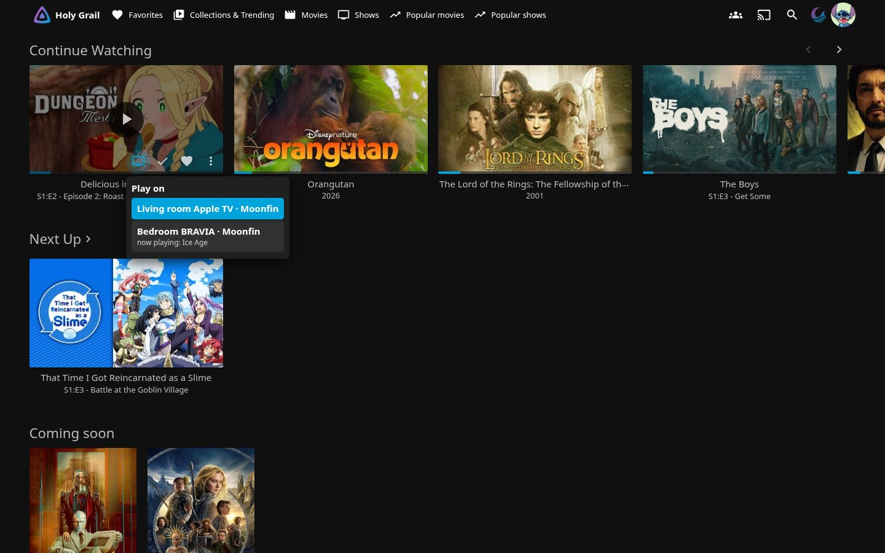
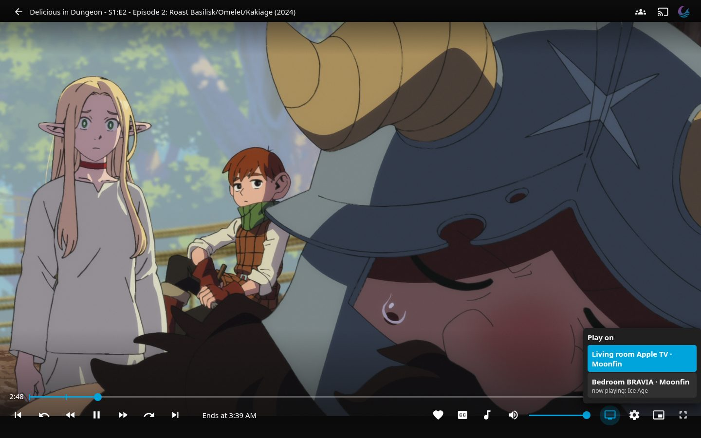
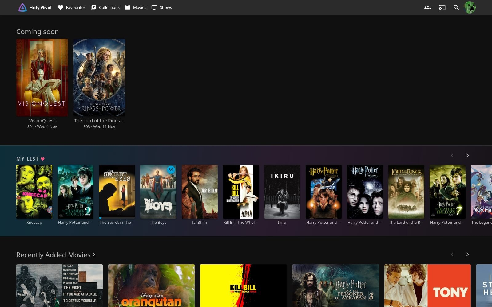
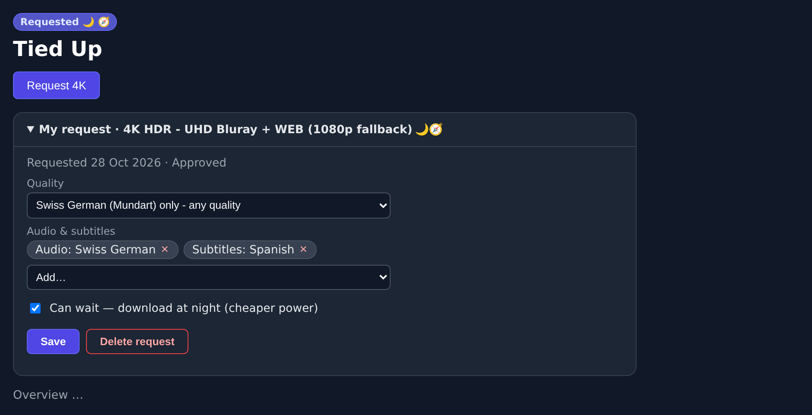

# What's new

Newest first. Each entry: what changed, where to click, and the page with the details.

## 31 October 2026

**Subtitle sources in the bar.** The bar above Requests now also shows the subtitle providers: SubDL ≈ searches/2000 and downloads/50 per day, OpenSubtitles downloads; red with the retry time when paused. Resets at 01:00. [The indexer bar](apps/requests.md#the-indexer-bar-at-the-top)

**Remove from Continue watching.** Not interested anymore? On the website, point at the title in **Continue watching** and click the **crossed-out eye** (phone: tap it top right), with 5 s **Undo**. Only the resume point is cleared; watched status, favourites, My List and Next up stay. In Moonfin: long press → **Hide from Continue Watching** (also clears the play history). [Remove from Continue watching](apps/jellyfin-home.md#remove-from-continue-watching)

**Play on TV: one subtle TV icon everywhere.** Top 10 and Popular cards of titles you own now have it too. [Play on TV](apps/jellyfin-home.md#play-on-tv)

**▶ Play on TV, everywhere.** Open Moonfin on your TV. In Jellyfin on the website, tap the **TV icon** on any card, title page or episode row and pick your TV. In the player it is called **Continue on TV**: the TV carries on at the same second. [Play on TV](apps/jellyfin-home.md#play-on-tv)

{ loading=lazy }

{ loading=lazy }

**Smarter version choice.** Better picture and sound win. Extra dubs, bonus material and season packs only break ties between otherwise equal versions. [Which version gets downloaded](apps/requests.md#which-version-gets-downloaded)

**Who requested what.** On the Requests page and on a title page, a small pill shows where a request came from (**via Jellyfin**, **via Moonfin**, **via TV**), with the right person's name. [Who requested what](apps/requests.md#who-requested-what)

**Skip intros automatically, per person.** Profile picture → **Settings** → **Playback** → **Media Segment Actions** → **Intro** → **Skip**. In Moonfin: **Settings** → **Playback** → **Skipping & Autoplay**. [Skip intros automatically](apps/jellyfin.md#skip-intros-automatically)

**New guide pages:** [How to use the media stack](apps/media-guide.md) (one page, all apps) and [Which subtitle track is which?](audio-subtitles.md#which-subtitle-track-is-which)

## 30 October 2026

**Moonfin app on TV and phone.** Install it, sign in with **Quick Connect**, and request films right in the app (**Request** → under *Advanced*: 🌙 Tonight or ⚡ Now). [Moonfin app](apps/moonfin.md)

**Code for TV (Samsung).** Jellyfin website → **Popular movies** or **Popular shows** → **Code for TV** (top right). Type the code into Moonfin within 10 minutes. [Code for TV](apps/moonfin.md#4-samsung-requests-sign-in-with-code-for-tv)

**New home rows.** A random showcase at the top, Continue Watching and Next Up as separate rows, and **Hidden Gems**: well-rated titles you have not watched. Top 10 posters show a 🇨🇭 rank badge. [Home screen](apps/jellyfin-home.md#rows-top-to-bottom)

## 29 October 2026

**Popular movies and Popular shows.** Netflix CH Top 10 plus lists per service and genre. Top bar or side menu → **Popular movies** / **Popular shows** (on the TV: 🎬 and 📺 next to search). Each card: **🌙 Download tonight** or **⚡ Download now**. [Popular movies and shows](apps/jellyfin-home.md#popular-movies-and-shows)

**Home screen redesign.** The same rows for everyone: Continue Watching, Next Up, Coming soon, My List ♥, Recently added, Studios and Networks, and more. [Home screen](apps/jellyfin-home.md)

{ loading=lazy }

**Audiobook library and sizes.** On the audiobook requests site: **Library** page and a size column. [Library](apps/audiobook-requests.md#library)

## 28 October 2026

**My request card.** On a title page in Requests, open **My request** to change the quality, languages or delete your request (the files stay). [My request](apps/requests.md#my-request-see-and-change-it)

{ loading=lazy }

**Clear status badges and sizes.** Every request shows a symbol (🌙 tonight, ✅ available, ◐ partly, 📅 not released); tap it for a hint. Sizes on the Requests page (sortable). [Sizes](apps/requests.md#sizes)

## 27 October 2026

**Skip intro and credits buttons** in Jellyfin. Press **Skip intro** when it appears. [Skip intro & credits](apps/skip-buttons.md)

**Your profile picture everywhere.** Pick it once; it is copied to Jellyfin, Requests and Home Assistant. [Profile picture](apps/profile-picture.md)

**Can wait: download tonight.** In the request dialog, ticked by default: downloads at night when power is cheaper. [Can wait](apps/requests.md#can-wait-download-tonight)

## 26 October 2026

**Audiobook requests.** Request audiobooks (5 a week); they appear in Audiobookshelf. Open `books.holy-grail.ch`, or **Audiobooks** in the Requests menu. [Requesting audiobooks](apps/audiobook-requests.md)

**New watch history.** The Tracker starts fresh; Jellyfin, Requests and Audiobookshelf sync on their own. [Watch history](apps/tracker.md)

## 25 October 2026

**This guide.** Dashboard → **Account** → **Guide**. [Home](index.md)

**Automatic subtitles** when the audio is not your language. [Subtitles automatically](audio-subtitles.md#subtitles-automatically-when-the-audio-isnt-your-language)
